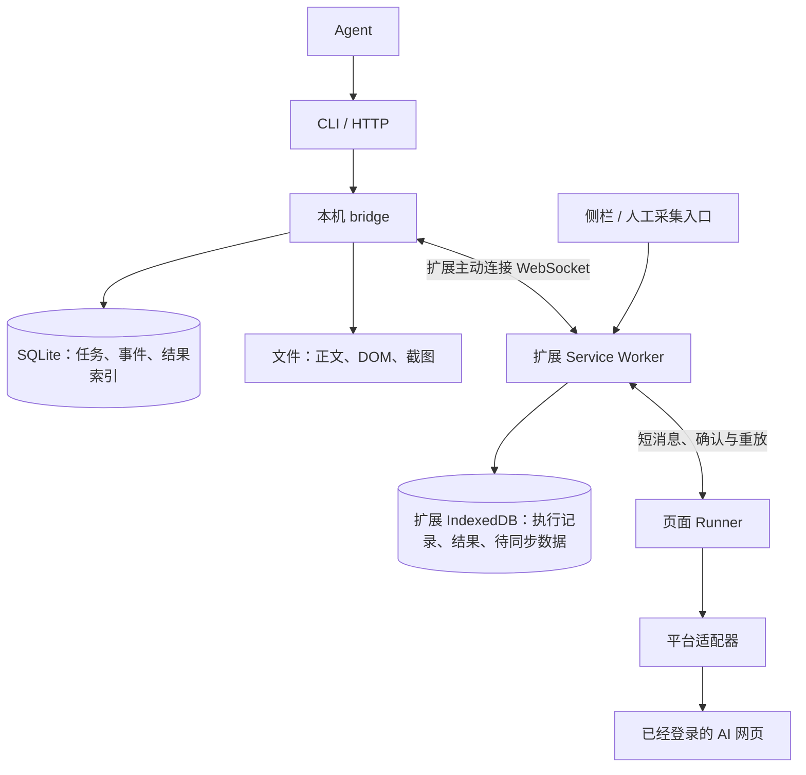

# GEO 自动采集插件：开发前技术调研与架构设计

调研日期：2026-11-11。

需求依据：[GEO 采集插件：Agent 的浏览器采集工具](http://127.0.0.1:27182/api/shares/s-x-676a15e50d2c/resolve)。历史参考：[旧项目记录](../归档/旧项目记录.md)。

## 1. 结论与验证边界

项目可以采用“Chrome MV3 扩展 + 本机 bridge + CLI”实现。最大的技术难点是正确识别当前轮次、判断回答完成，以及故障恢复时避免重复提问。

需要明确的能力边界：

- 无法保证任意网站永久自动适配。
- 无法保证冻结页面继续运行。
- 无法保证所有后台页面都能获得完整截图。
- HTTP 幂等能够防止重复创建任务，但不能让网页提交与本地数据库组成原子事务。

本方案依据需求文档、旧项目归档、Chrome 官方文档及本机运行环境检查。真实平台 DOM、登录后的页面行为和截图效果尚未实测，必须通过开发前期的验证门槛。文中的架构、参数与验收数量属于设计建议，不代表已有实现或验证结果。

## 2. 产品职责

Agent 理解用户目标、选择问题与平台、分析结果、决定下一步。插件执行确定性的输入、发送、等待、提取与保存。

一次 `run` 覆盖完整采集流程，不要求模型逐次点击或持续观察。调用方式按照渐进式披露组织：

```text
短接管入口 → help → 单项动作文档 → 提交任务 → 查询状态 → 按需读取结果
```

采集正文和引用是核心交付；HTML、QA DOM、截图和诊断作为独立材料按需读取。人工采集、会话管理和报告导出与 Agent 接口共用执行与数据机制。

## 3. 整体架构



真正运行的只有一个本机进程和一个浏览器扩展。CLI 是本机服务的客户端，runner 是扩展注入页面的代码。

| 部分 | 推荐实现 | 职责 |
|---|---|---|
| 扩展 | 原生 JavaScript、HTML、CSS，Manifest V3 | 连接、页面协调、人工界面、存储 |
| 页面 runner | Content Script，默认运行在隔离环境 | 输入、发送、等待、提取、验证 |
| 平台适配器 | 每个平台独立模块，共用统一接口 | 平台特有的输入方式、轮次结构和完成信号 |
| bridge | Node.js，原生 HTTP，成熟 WebSocket 库 | 任务接收、持久化、结果查询 |
| CLI | Node.js，共享协议定义 | 离线帮助、调用、等待、文件下载 |
| bridge 存储 | SQLite + 独立产物文件 | 事务、幂等、事件游标、结果保存 |
| 扩展存储 | IndexedDB + 少量 chrome.storage.local | 执行归属、待同步结果、设置 |
| 测试 | Node 内置测试 + Playwright Chromium | 协议、故障注入、真实扩展环境 |

首版不需要前端框架、独立队列服务、云数据库或模型 SDK。MCP、Native Messaging 不作为首版必需接入层。

本机已确认 Node `v26.12.0` 可以使用 `node:sqlite`，并成功执行内存数据库查询，返回 SQLite `3.54.1`。项目应固定经过测试的 Node 版本范围，不直接承诺所有 Node 版本均可运行。[Node SQLite 文档](https://nodejs.org/api/sqlite.html)

## 4. 连接与后台生命周期

### 4.1 HTTP 对外，WebSocket 连接扩展

Agent 通过 `/help`、`/docs`、`/command`、`/tasks` 等 HTTP 接口工作。扩展主动连接同一个本机服务的 WebSocket，接收任务与停止指令，上报进度与结果。服务默认监听 `127.0.0.1:8787`。

WebSocket 可以及时传递命令，并避免扩展持续请求命令队列。Chrome 116 起，WebSocket 收发消息能够重置扩展后台的空闲计时；官方示例使用 20 秒心跳。[官方 WebSocket 指引](https://developer.chrome.com/docs/extensions/how-to/web-platform/websockets)

连接规则：

- 用户启用 Agent 连接后维持连接，主动断开后停止重连。
- 连接断开采用退避重试，alarm 作为后台重新唤醒的补充。
- 重连先同步执行状态和未确认事件，再允许新任务进入。
- 首版同时使用一个扩展连接，新连接替换旧连接，无固定实例绑定。
- HTTP 协议版本与扩展版本分别记录，不兼容时明确拒绝执行。

心跳提高在线率，但不构成可靠性的基础。Chrome 要求扩展能够承受后台意外终止；alarm 不能唤醒休眠中的电脑。[后台生命周期](https://developer.chrome.com/docs/extensions/develop/concepts/service-workers/lifecycle/)、[alarm 行为](https://developer.chrome.com/docs/extensions/reference/api/alarms)

### 4.2 网络职责

本机连接放在扩展后台，runner 通过扩展消息转发。Content Script 的跨域请求受网页来源约束，扩展后台可以在获得 host permission 后跨域请求。[Chrome 网络请求说明](https://developer.chrome.com/docs/extensions/develop/concepts/network-requests)

长流程由页面 runner 执行。后台负责短操作协调与持久化，不以等待一个长时间 `executeScript` Promise 作为流程主轴。

## 5. 任务模型与可靠性

### 5.1 状态与执行阶段

任务状态：

```text
queued → running → done
                 → failed
                 → suspended
                 → interrupted
```

`done`、`failed`、`suspended`、`interrupted` 为当前动作终态。修复不会自动重新提问。连接暂时丢失作为独立连接状态表达，不能直接等同于任务终态。

执行阶段单独记录：

```text
准备页面 → 定位输入 → 填写 → 记录发送意图
→ 提交 → 确认本轮问题 → 等待完成 → 提取 → 持久化
```

每个任务至少保存：

```text
taskId、requestHash、idempotencyKey
extensionInstanceId、tabId、documentId、runnerId
status、step、revision、lastEventSeq
submissionState、resultAvailable、error
```

### 5.2 网页提交的不确定窗口

HTTP 幂等只能防止同一请求创建两条任务，不能消除以下窗口：

```text
页面已经点击发送
        ↓
后台尚未记录发送成功
        ↓
页面或浏览器崩溃
```

网页操作与本地数据库无法组成同一个事务。采用以下策略：

1. 点击前持久化“准备提交”，成功后才允许点击。
2. runner 对同一执行实例只允许进入一次提交分支。
3. 恢复后先验证当前页面是否存在本轮问题。
4. 无法确定时返回 `submission_unknown`，保留证据，禁止自动再次发送。

这是优先避免重复副作用的设计，可能使部分未完成提交需要重新判断，不能宣称网页发送严格“恰好一次”。

### 5.3 执行归属与对账

扩展负责执行归属，bridge 负责调用记录和持久化查询。人工入口和 Agent 入口都通过扩展同一个执行闸门。

bridge 保存已接受任务；扩展保存执行者和执行阶段。断线时 bridge 标记连接丢失和状态更新时间，不立即假定页面任务失败，也不派发替代任务。

重连根据任务 ID、执行实例、事件序号对账。浏览器重启后不能只凭旧 `tabId` 恢复，必须重新核实文档与 runner 身份。不匹配的 runner 事件不能覆盖当前任务。

首版页面动作串行执行。忙时返回已有任务链接，停止指令通过独立控制路径送达。未确认旧执行者退出前，不释放执行闸门供新任务发送。

### 5.4 持久化与两级确认

```text
runner → 扩展 IndexedDB 写入成功 → 本地确认
扩展 → bridge 事务写入成功 → 同步确认
```

结果在本地确认前保留在 runner 缓冲中，在同步确认前保留在扩展待发送队列中。事件按 `(taskId, runnerId, seq)` 去重。

正文保存完成后再执行截图。截图失败不能覆盖已保存的正文。页面在尚未完成本地持久化前消失，仍可能丢失未确认内容，应如实报告。

## 6. 平台适配与元素验证

### 6.1 统一能力接口

每个平台实现同一组能力：

```text
检查页面是否就绪
定位并填写输入框
提交问题
识别本轮问题与回答
判断生成状态
提取正文与引用
生成定位诊断
```

四类角色保留可配置定位，但四个 CSS 选择器不足以覆盖完整的平台行为。选择器配置适合修复节点位置或 class 变化；引用需要打开弹层、生成结束信号变化等问题需要修改适配器。

### 6.2 角色验证

| 角色 | 必须满足的条件 |
|---|---|
| 输入框 | 当前输入区域内、可编辑、可见；填写后内容核对一致 |
| 发送按钮 | 属于当前输入区域、可用；避免误点停止或语音按钮 |
| 问题 | 与本次输入规范化后匹配，且属于提交后新产生的轮次 |
| 回答 | 与本轮问题关联，排除历史回答、思考区、侧栏及整个页面 |

提交前保存已有轮次标识，提交后识别新增轮次。仅靠问题文本相同或取最后一个回答都不够，重复提问和 DOM 重建都可能造成误判。

多个候选先通过容器关系、轮次标识和语义规则排除；仍无法区分则返回 `ambiguous`。

Content Script 默认处于隔离环境，可以操作 DOM，但不能直接读取页面 JavaScript 变量。确需进入页面主环境时，限制为具体平台的小范围输入操作。[Content Script 隔离机制](https://developer.chrome.com/docs/extensions/develop/concepts/content-scripts)

### 6.3 诊断与修复

失败发生时保存失败角色、原因、有限候选、剪枝 DOM、相关事件及可选截图，区分历史证据与当前页面检查。

DOM 剪枝去除 script、style、SVG path 等噪声，限制深度、文本量和候选数量。页面骨架变化只作为复核线索，不能代替语义验证。

`fix` 使用两步：

```text
testOnly：返回验证结果及页面/配置版本
保存：重新验证，并检查页面和配置版本未变化
```

保留最近 20 次配置历史，历史采集结果引用当时的配置版本。不能用测试时的页面状态直接证明保存时仍然有效，也不能修复后静默改写旧结果。

## 7. 回答完成判断与采集已有对话

完成判断组合三个信号：

- 本轮回答确实已经出现。
- 平台生成状态已经结束，或出现明确完成标志。
- 正文经过平台适用的稳定窗口，内容没有继续变化。

稳定窗口只是辅助证据。网络停顿、后台节流、页面冻结都可能让正文暂时不变。

实现上使用 `MutationObserver` 观察相关对话区域，配合低频检查和绝对截止时间。超时返回错误及已观察到的部分内容，标明 `complete: false`。短回答不能因为未达到统一字数阈值而无限等待。

长思考、联网搜索、深度研究作为不同模式处理。首版先验证普通问答和明确的联网问答模式，不将普通问答结束规则直接用于长任务。

`collect` 行为：

- 单一候选对话时可自动选择。
- 多个标签页时要求 `tabId`，返回候选摘要。
- 不提交新问题。
- 当前回答仍在生成时，等待或按明确参数返回部分内容。

## 8. 后台页面与停止语义

隐藏、冻结、丢弃是不同状态。隐藏页面可能变慢，冻结页面的可冻结任务会暂停，被丢弃后执行上下文会消失。[Page Lifecycle API](https://developer.chrome.com/docs/web-platform/page-lifecycle-api)

执行规则：

- `--no-focus` 表示不主动前置，不表示页面一定持续正常执行。
- 保留页面可见性、最后心跳、最后正文变化时间。
- 心跳消失先表示联系中断，不能据此判断生成完成。
- 页面刷新或关闭后，核实 runner 已不存在，再进入 `interrupted`。
- 未确认旧执行者退出前，不允许新任务继续发送。

`stop` 区分两个事实：插件自动化流程是否停止，以及网站自身的回答生成是否停止。

首版默认停止插件后续操作。如提供“同时点击网站停止按钮”，必须有明确参数和独立结果。停止请求被接受不等于页面流程已停止；无确认时保持真实的未确认状态。

## 9. 截图方案与权限

`captureVisibleTab()` 截取指定窗口中活动标签页的可见区域，需要 `<all_urls>` 或有效的 `activeTab` 权限，不能作为任意后台标签页截图接口。[Tabs 截图接口](https://developer.chrome.com/docs/extensions/reference/api/tabs#method-captureVisibleTab)

推荐方案：

- 正文与引用作为核心采集结果。
- 节点截图使用 `chrome.debugger` 调用 CDP 截图能力，先做实际验证。
- 记录截图方式、范围、时间和失败原因。
- `--no-focus` 下截图失败时返回原因，不偷偷激活标签页。
- 超长或虚拟化内容不承诺一张图完整覆盖。

`debugger` 不能作为 optional permission。完整截图采用该路径时，需要在 manifest 中声明；功能可以按需启用，安装权限本身不是按需申请。[可选权限限制](https://developer.chrome.com/docs/extensions/reference/api/permissions)

调试会话可能因打开 DevTools 或关闭页面而断开，需要处理 `onDetach`。[Debugger API](https://developer.chrome.com/docs/extensions/reference/api/debugger)

首版先验证一条截图路径，不同时实现 DOM 转图片、滚动拼接、CDP 三套自动回退。后续加入 DOM 重绘图时，明确标记为重绘结果，与页面实拍区分。

## 10. 存储与数据交付

### 10.1 bridge 存储

SQLite 保存任务、幂等记录、事件、结果索引和诊断索引。正文、HTML、DOM、PNG 放独立文件。

约束：

- 幂等键和任务创建放在同一个事务中。
- 同键同参数返回原任务，同键不同参数返回冲突。
- 先完成产物文件写入，再提交可查询的结果索引。
- 默认查询只读摘要，分页读取正文与引用。
- 幂等记录保留期间，不因清理大文件而失去防重能力。
- 大文件传输有大小限制、校验及背压，避免阻塞停止消息。

### 10.2 扩展存储

IndexedDB 保存执行记录、待同步结果和人工会话数据。`chrome.storage.local` 只存设置与少量连接信息，其默认容量有限，不作为截图仓库。[Storage API](https://developer.chrome.com/docs/extensions/reference/api/storage)

Chrome 扩展消息采用 JSON 序列化，不能假设 Blob 能通过 `runtime.sendMessage` 原样传递。大内容分块传输或使用专门的产物上传通道。[消息序列化](https://developer.chrome.com/docs/extensions/develop/concepts/messaging)

### 10.3 分层结果

| 内容 | 默认策略 |
|---|---|
| task | 状态、阶段、更新时间、下一步链接 |
| result | 摘要、字数、引用数、可用视图 |
| text / html / qa | 显式读取，支持分页 |
| citations | 显式读取，提供总数与分页信息 |
| diagnostic | 默认摘要，详细证据另取 |
| screenshot | 独立 PNG 文件接口 |

正文默认每页 4000 字符，单页上限 20000；明确总长度和下一页位置。默认响应不包含正文全文、整页 DOM 或 Base64 图片。

只有实际存在的产物才返回对应链接。正文、引用与截图分别描述采集结果，不能用引用数量为零掩盖引用提取失败。

## 11. HTTP 与 CLI 合同

沿用需求中的接口：

| 接口 | 作用 |
|---|---|
| `GET /help` | 简短能力目录 |
| `GET /docs`、`GET /docs/{topic}` | 文档目录与单项合同 |
| `GET /status`、`GET /platforms` | 连接与任务摘要、平台能力 |
| `POST /command` | 提交动作，返回任务 ID 与后续链接 |
| `GET /tasks/{id}` | 轻量任务查询 |
| `GET /tasks/{id}/result` | 摘要或指定视图 |
| `GET /tasks/{id}/artifacts/screenshot` | PNG 文件 |
| `GET /events` | 按任务和游标读取新增事件，支持有界等待 |
| `GET /diagnostic/{id}` | 历史诊断与证据入口 |

动作包括 `run`、`collect`、`inspect`、`dom`、`shot`、`fix`、`anchors`、`stop`。实际 help 只列出当前实现的能力。

必须补齐的语义：

| 问题 | 设计决定 |
|---|---|
| 同平台多个标签页 | 支持 tabId，歧义时返回候选 |
| 页面节点引用 | 使用绑定 documentId 的短期 nodeRef，导航后失效 |
| 超时 | 分开定义任务截止时间、连接超时、CLI 等待超时 |
| 部分结果 | resultAvailable 与成功状态独立 |
| 停止对象 | 支持明确 taskId，返回是否已确认停止 |
| 平台能力 | 分别声明 run、collect、引用、截图、验证级别 |
| 断线状态 | 暴露连接状态、最后更新时间、是否等待对账 |
| 配置保存 | 验证配置版本，拒绝覆盖更新后的配置 |
| 引用完整性 | 区分未发现引用、已提取引用、引用提取失败 |

help、参数校验、HTTP 和 CLI 共用动作定义。单项文档完整描述参数、前提、副作用、响应、错误、重试和下一步。

CLI 的帮助和文档离线可读，stdout 输出 JSON，进度写 stderr。等待超时只结束 CLI 等待，不取消页面任务。截图通过指定输出文件保存。

载荷预算沿用需求：无目标接管入口约 500 个中文字符以内；help 约 4KB JSON 以内；正常状态和摘要各约 2KB JSON 以内。预算用实际字节数验证，不将字节数宣称为精确 token 数。

## 12. 本机连接与数据边界

- 服务只监听 `127.0.0.1`，CLI、HTTP 与 WebSocket 直接连接，无需本地认证或扩展配对。
- 默认数据目录为 `~/.geo-bridge`，支持通过 `GEO_BRIDGE_HOME` 指定。
- WebSocket 建立后核对协议和扩展版本，恢复任务记录后接收动作。
- 不提供任意 JavaScript 执行接口。
- 网页正文作为数据交付；诊断和报告预览不得直接执行采集到的 HTML。

Chrome 已引入网页访问本地网络的权限机制，但通用说明不能直接证明目标版本下扩展连接的所有行为，应纳入真实 Chrome 连接验证。[Local Network Access](https://developer.chrome.com/blog/local-network-access)

## 13. 难度与风险

下表为工程判断，不是已实测的失败概率。

| 风险 | 难度 | 主要后果 | 控制方式 |
|---|---|---|---|
| 轮次关联与回答完成判断 | 很高 | 保存旧答案或未完成答案 | 平台专用规则、反例测试、失败挂起 |
| 提交瞬间故障 | 很高 | 重复提问或漏执行 | 发送意图持久化、不确定时不重发 |
| 多平台 DOM 长期变化 | 高 | 适配持续失效 | 独立适配器、版本与验证记录 |
| 引用分散在弹层或侧栏 | 高 | 引用漏采、错配 | 单独引用流程及完整性状态 |
| 后台、冻结、丢弃 | 高 | 等待停滞、上下文丢失 | 生命周期检测、截止时间、真实中断状态 |
| 节点与长页面截图 | 高 | 空白、缺失、错截 | 单独能力验证、尺寸限制、明确降级 |
| 登录、验证码、额度限制 | 高且外部决定 | 自动化无法继续 | 可识别错误和人工恢复入口 |
| bridge 与扩展断线对账 | 中高 | 状态分裂、重复记录 | 两级确认、序号去重、归属检查 |
| HTTP、CLI、分页、帮助 | 中低 | 调用体验与兼容性问题 | 共用合同、接口测试 |
| 侧栏、会话、导出 | 中 | 数据展示或导出错误 | 共用状态、产物核对 |

九个平台逐个验收，不因 Perplexity 成功就标记全部可用。自定义 HTTPS 平台首版定位为可配置、待验证，不承诺填写四个选择器即可可靠执行。

## 14. 实施顺序与验证门槛

### 阶段一：扩展到本机服务

实际加载扩展，验证连接、断线重连、侧栏关闭、后台停止和浏览器重启。通过条件：连接确实恢复，恢复过程不会新增页面任务。

### 阶段二：Perplexity 真实采集

覆盖新提问、采集已有对话、重复问题、短回答、长回答、引用和后台标签页。逐条核对问题与答案属于同一轮。

### 阶段三：故障边界

在发送前、发送后、结果保存前和截图时主动制造中断。通过条件：不重复提交、已保存正文不丢失、状态不伪装成功。

### 阶段四：协议和人工使用闭环

完成 help/docs、CLI、结果分页、配置修复、会话管理和报告导出。人工入口与 Agent 使用同一执行机制。

### 阶段五：逐平台扩展

复用执行框架，分别实现和验证 ChatGPT、Claude、Gemini、豆包、元宝、Kimi、千问、DeepSeek 的输入、轮次、结束判断与引用提取。平台注册不等于能力验收。

## 15. 测试环境与交付标准

自动化扩展测试使用 Playwright 自带 Chromium 和独立持久化配置目录。官方提示常规 Chrome/Edge 已移除相关命令行侧载扩展开关，不能照搬旧启动脚本。[Playwright 扩展测试](https://playwright.dev/docs/chrome-extensions)

生产使用是用户正常 Chrome 中加载扩展，不要求通过远程调试端口接管日常浏览器。Chrome 136 起对默认用户数据目录的远程调试增加了限制。[Chrome 远程调试变更](https://developer.chrome.com/blog/remote-debugging-port)

验证分为四层，分别记录结果：

1. 代码与合同检查：参数、状态、分页、帮助、连接。
2. 模拟与故障注入：重放、幂等、任务归属、持久化和恢复。
3. 实际扩展环境：安装、连接、后台生命周期和截图权限。
4. 真实平台采集：当前页面输入、轮次、结束判断、引用与导出核对。

首个可交付版本应满足：

- Perplexity 完成真实 run 和 collect。
- 正文、引用、诊断能够保存并按需读回。
- 重复投递、重连和后台重启不会自动重复提问。
- 错误选择器能够挂起，实测修复后可以重新采集。
- 截图成功与失败都有明确结果。
- 人工入口、CLI、HTTP 展示一致的任务状态。
- 其余平台逐项标明已实现能力及验证状态。

建议第一平台至少完成 20 次有代表性的真实采集，轮次错配为零；各关键故障窗口重复验证，单独记录限制条件。这是验收门槛建议，不代表已证明长期稳定。

开发优先验证真实页面采集与故障恢复。两项通过后，再扩大界面和多平台投入。版本号由 manifest 统一提供，代码开发每轮按项目约定递增最后一段；安装、发布和用户电脑操作按明确授权执行。
